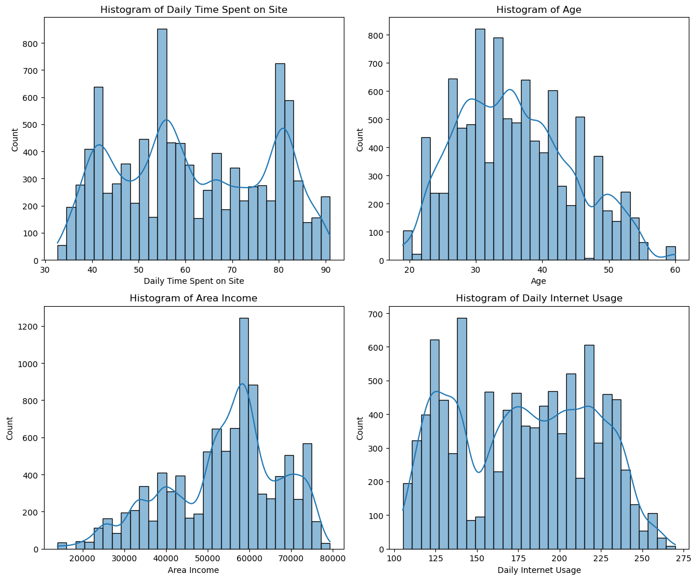
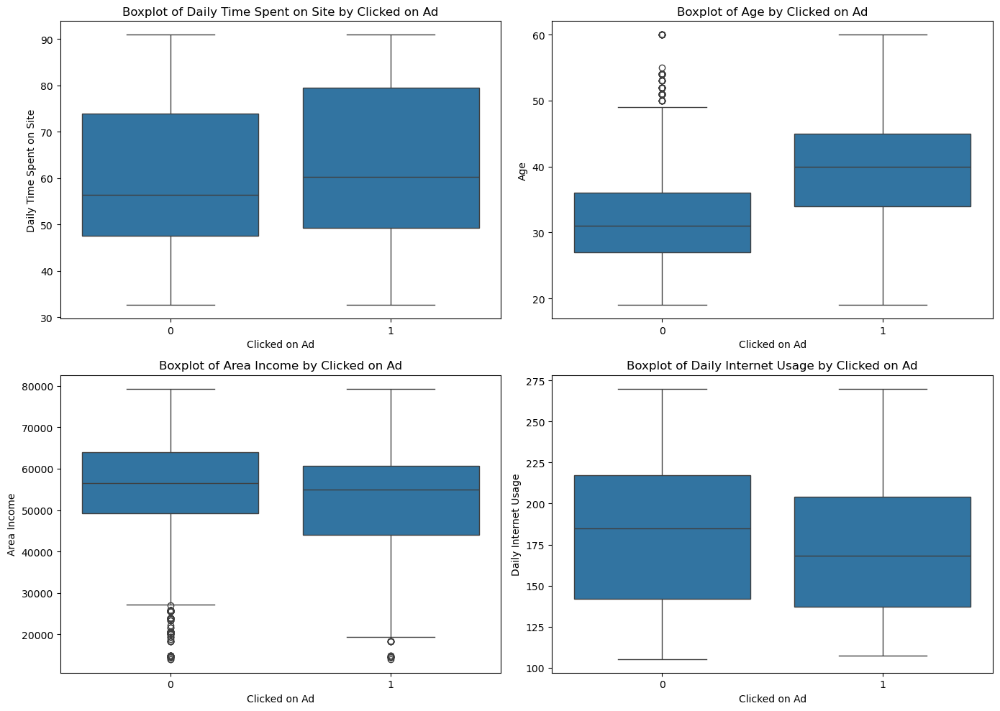
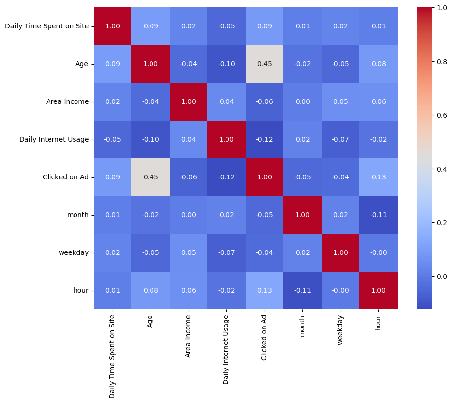
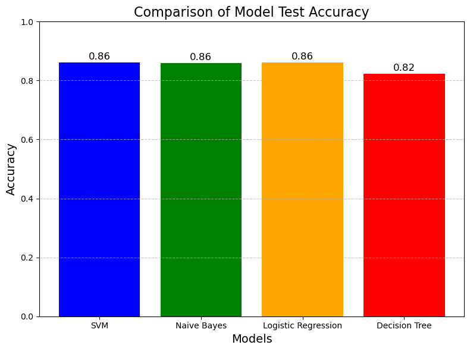

# Predicting Click-Through Rates Using Machine Learning Models

Binary classification of online-advertisement clicks, comparing four classical algorithms **implemented from scratch with NumPy** against their **Scikit-learn counterparts**.

Academic project, National School of Applied Sciences of Tetouan (ENSA Tetouan), field of study: Big Data & AI.

## Overview

Click-Through Rate (CTR) prediction is a core task in online advertising. This project predicts the binary target `Clicked on Ad` (0 = no click, 1 = click) from demographic, behavioral and contextual features.

Objectives:

- Understand the dataset through exploratory analysis.
- Prepare numerical and high-cardinality categorical features for modeling.
- Implement Decision Tree, Logistic Regression, Naive Bayes and SVM from scratch to understand their mathematical mechanics.
- Compare their performance with each other and with the Scikit-learn implementations in the notebook.

## Dataset

- **Source:** [Kaggle - Click-Through Rate Prediction](https://www.kaggle.com/datasets/swekerr/click-through-rate-prediction)
- **File:** `data/advertising.csv` (10,000 rows, 10 columns, no missing values, 215 exact duplicates)
- **Target:** `Clicked on Ad` (0: 5,083 rows, 1: 4,917 rows)

| Feature | Type |
|---|---|
| `Daily Time Spent on Site` | numerical |
| `Age` | numerical |
| `Area Income` | numerical |
| `Daily Internet Usage` | numerical |
| `Ad Topic Line` (559 unique values) | categorical |
| `City` (521 unique values) | categorical |
| `Country` (207 unique values) | categorical |
| `Gender` | categorical |
| `Timestamp` (2016-01-01 to 2016-07-23) | datetime |

See [`data/README.md`](data/README.md) for download instructions.

## Exploratory Data Analysis

Performed in the notebook:

- Missing values check (none) and duplicate removal (215 rows, leaving 9,785).
- Boxplots and histograms of the four numerical features.
- Boxplots and density plots of each numerical feature by target class.
- Gender distribution of clicks, and click counts by hour, weekday and month (derived from `Timestamp`).
- Correlation heatmap: `Age` has the strongest positive correlation with the target (0.45).

## Data Preprocessing

1. Remove duplicate rows (9,785 remaining).
2. Split into train/test sets: 80/20, `random_state=42` (7,828 training rows, 1,957 test rows).
3. **Target encoding** of `City`, `Gender`, `Ad Topic Line` and `Country` (`category_encoders.TargetEncoder`), fitted on the training set only to avoid leakage.
4. **Standardization** of all features (`StandardScaler`), fitted on the training set only.

Model inputs: the 4 numerical features + the 4 target-encoded categorical features. `month`, `hour` and `weekday` are extracted from `Timestamp` and used in the EDA only (see [Known limitations](#known-limitations)).

## Machine Learning Approaches

### From-scratch implementations (`src/`, NumPy only)

| File | Algorithm | Notes |
|---|---|---|
| [`Decision_Tree_model.py`](src/Decision_Tree_model.py) | Decision Tree | Gini impurity, recursive best-split search, stopping on `max_depth` / `min_samples_split` / no information gain |
| [`Logistic_Regression_model.py`](src/Logistic_Regression_model.py) | Logistic Regression | Sigmoid, batch gradient descent, 0.5 threshold. Run with `learning_rate=0.01`, `n_iterations=10000` |
| [`Naive_Bayes_model.py`](src/Naive_Bayes_model.py) | Gaussian Naive Bayes | Per-class mean, variance and priors, log-posterior argmax |
| [`SVM_model.py`](src/SVM_model.py) | Linear SVM | Hinge loss with L2 regularization, per-sample gradient descent. Run with defaults (`iterations=1000`, `lr=0.01`, `lambdaa=0.01`) |

### Scikit-learn implementations (notebook only)

`DecisionTreeClassifier`, `GaussianNB`, `LogisticRegression` and `SVC` (default parameters, i.e. RBF kernel) are trained in `notebooks/ctr_prediction_analysis.ipynb` as a reference. They are not part of the PDF report, which only describes the from-scratch implementations.

## Evaluation Methodology

- Single hold-out split (80/20, `random_state=42`), without stratification.
- Metrics: accuracy on train and test sets, confusion matrices, classification reports (precision, recall, F1).
- No cross-validation and no hyperparameter tuning.

## Results

Accuracy values read from the saved outputs of the notebook:

| Model | From scratch (train / test) | Scikit-learn (train / test) |
|---|---|---|
| Decision Tree | not validated (note 1) | 0.9992 / 0.8298 |
| Naive Bayes | 0.8777 / 0.8595 | 0.8777 / 0.8595 |
| Logistic Regression | 0.8813 / 0.8620 | 0.8812 / 0.5166 (invalid, note 2) |
| SVM | 0.8794 / 0.8620 | 0.8912 / 0.8692 (note 3) |

1. The notebook cell labeled "Decision Tree from scratch" instantiates the Scikit-learn class (`max_depth=100`, train 0.9992, test 0.8227), not the class in `Decision_Tree_model.py`. The from-scratch tree is therefore not validated.
2. The Scikit-learn Logistic Regression test accuracy was computed on non-standardized test features (`X_test_encoded`) instead of the standardized ones. This value is a notebook bug, not a model result.
3. Scikit-learn's `SVC` uses an RBF kernel by default, while the from-scratch SVM is linear, so the two are not strictly equivalent.

**Observations:**

- The three validated from-scratch models (Naive Bayes, Logistic Regression, SVM) reach about 0.86 test accuracy, with train accuracy around 0.88.
- The decision tree reaches about 1.00 train accuracy against about 0.82-0.83 test accuracy, which indicates overfitting.
- From-scratch Naive Bayes matches Scikit-learn's `GaussianNB` exactly. From-scratch Logistic Regression is within 0.0001 of Scikit-learn's on the training set.

## Visualizations

**Feature distributions**

**Features by click behavior**

**Correlation heatmap**

**Model test accuracy comparison** (the Decision Tree bar comes from the Scikit-learn run, see note 1)

## Known limitations

- The from-scratch Decision Tree was never evaluated in the notebook (see note 1).
- The Scikit-learn Logistic Regression test accuracy (0.5166) is invalid because of a preprocessing bug (see note 2).
- `month`, `hour` and `weekday` are not used as model inputs.
- Single split, no cross-validation, no hyperparameter tuning: results may vary with another split.
- The SVM comparison is between a linear model (from scratch) and an RBF-kernel model (Scikit-learn).
  
## Contributors

- Aitbrahim Abdessamad
- Amazal Ayyoub
- Lagnaoui Yassir

Supervisor: Dr. Anas Belcaid. 

## References and Acknowledgments

- Dataset: [Click-Through Rate Prediction (Kaggle)](https://www.kaggle.com/datasets/swekerr/click-through-rate-prediction)
- The report cites online "from scratch" tutorials for Naive Bayes, SVM, Decision Tree and Logistic Regression as references for the implementations.